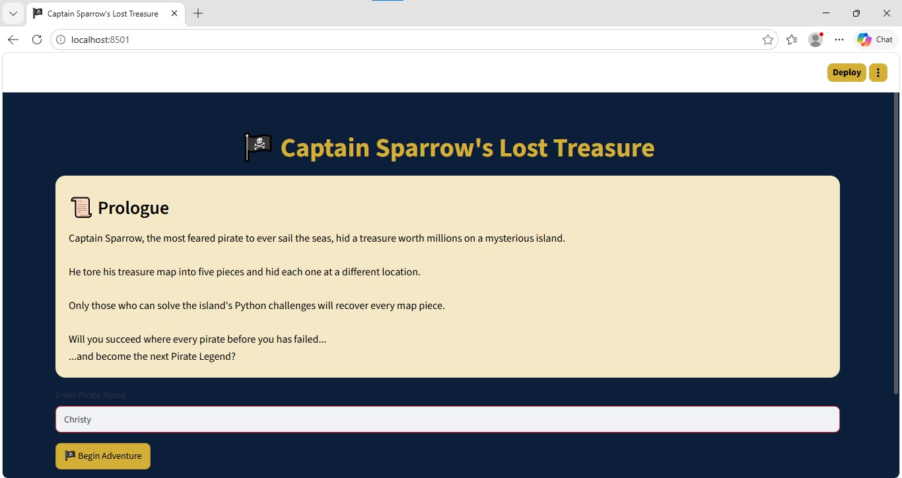
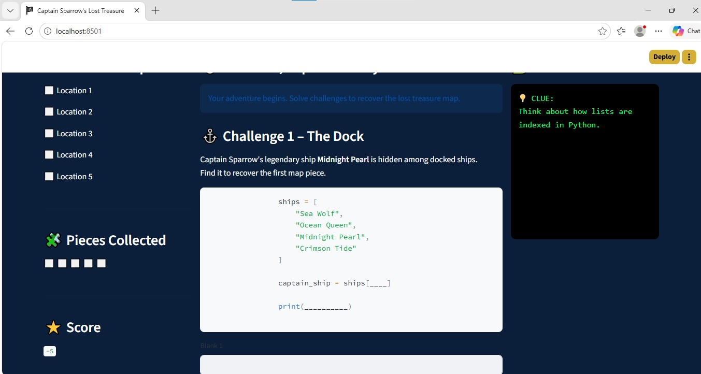
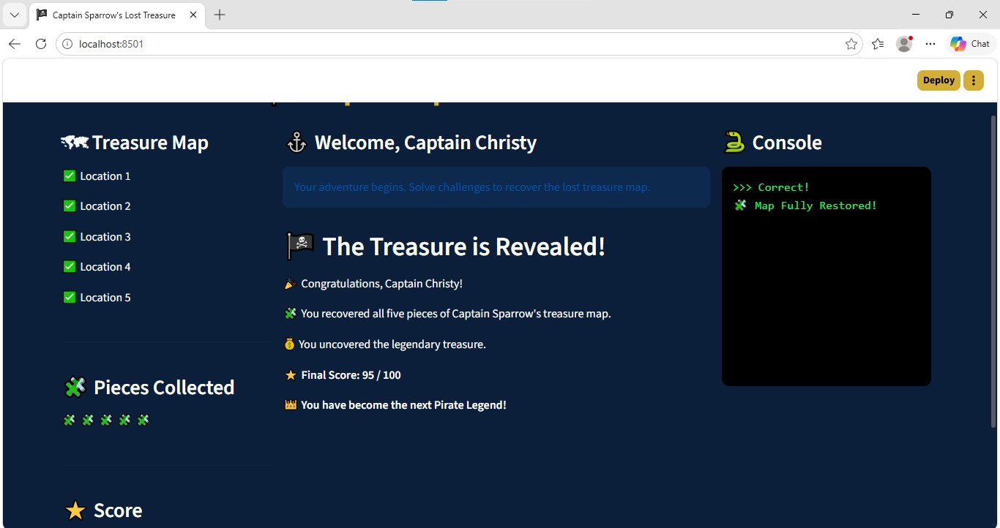
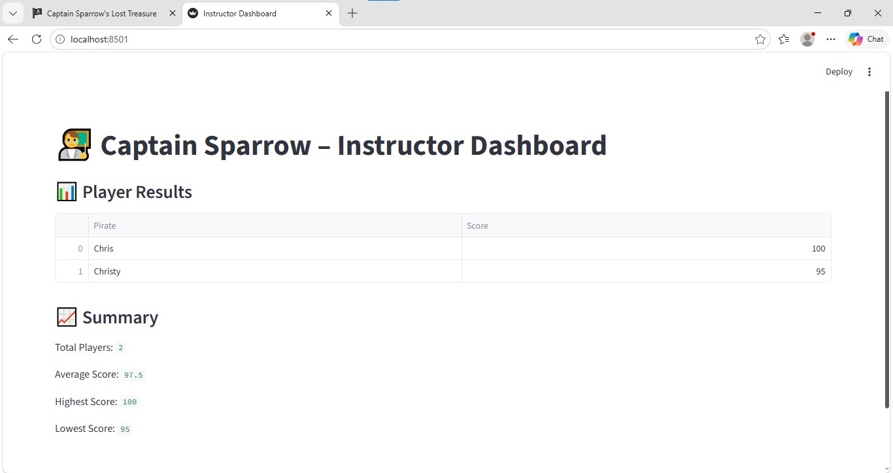

# 🏴‍☠️ Captain Sparrow's Lost Treasure

A gamified Python learning web app built with Streamlit. Players take on the role of a pirate, solve 5 Python challenges to recover a torn treasure map, and an instructor dashboard tracks everyone's scores.

> **Note:** I led the design of this project (game concept, challenge flow, scoring, hint system and instructor dashboard) and built it together with my friend Abyson Ninan, who helped me get started with running Python projects from the command prompt and an IDE. The code was written with AI assistance.

## 📸 Screenshots

**Start page**


**Hint system: using a clue costs 5 points**


**Final page**


**Instructor dashboard**


## ✨ Features
- **5 fill-in-the-blank challenges** covering list indexing, list methods, dictionaries, loops with conditions, and sets
- **Scoring:** 20 points per challenge, 100 points maximum
- **Hint system:** each challenge has a clue that costs 5 points (charged once per challenge)
- **Progress tracking:** a treasure map panel shows completed locations and collected map pieces
- **Console panel** that shows feedback, error-style messages and clues
- **Instructor dashboard** that reads saved scores and reports total players, average, highest and lowest score

## 🛠 Tech Stack
Python · Streamlit · Pandas

## 🚀 How to Run

1. Install the requirements:
```
pip install -r requirements.txt
```

2. Start the game:
```
streamlit run Treasure_hunt_activity.py
```

3. To view the instructor dashboard, open a **second** command prompt in the same folder and run:
```
streamlit run instructor.py
```

Scores are saved to `scores.csv` in the folder where you run the game, so both commands must be run from the same folder.

## 📁 Project Files
| File | Purpose |
|---|---|
| `Treasure_hunt_activity.py` | The game (player-facing web app) |
| `instructor.py` | Instructor dashboard that reads and summarizes scores |
| `requirements.txt` | Python packages needed |

## 👤 Author
**Christy Andrews** · [LinkedIn](https://www.linkedin.com/in/christy-andrews-15a7552b4)
